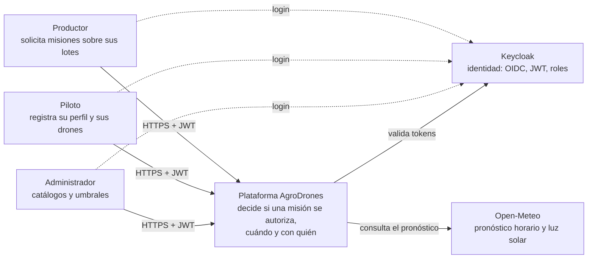
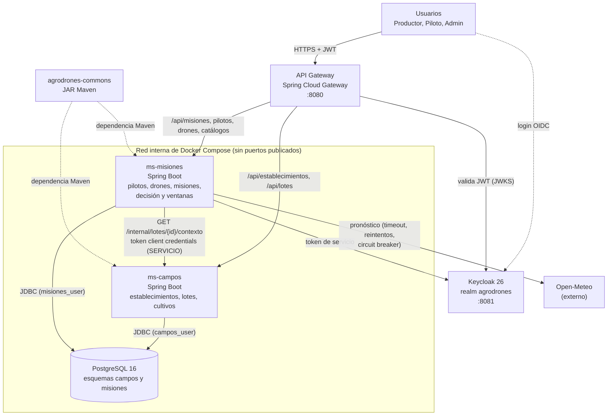
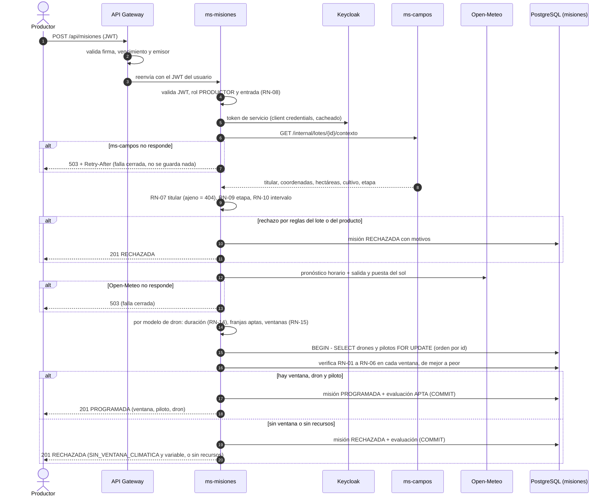
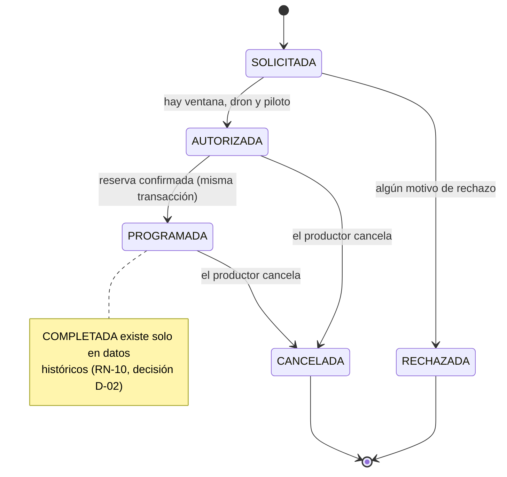
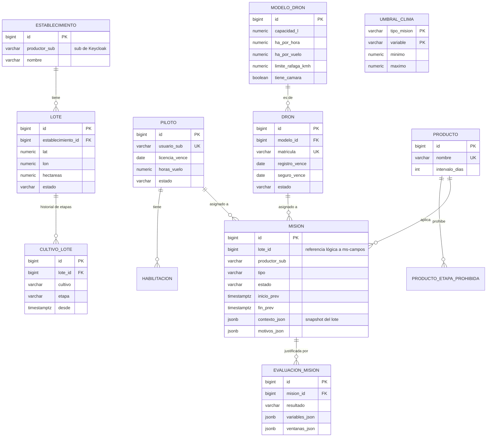

# Diagramas

Los diagramas representan la arquitectura implementada y desplegada con `docker-compose.yml`. Están escritos en Mermaid, que GitHub muestra como imagen.

## C1: contexto

## C2: contenedores

## Secuencia: solicitud de una misión

## Estados de la misión

## Modelo de datos

Los esquemas `campos` y `misiones` no tienen claves foráneas entre sí: `mision.lote_id` y `mision.productor_sub` son referencias lógicas a datos de `ms-campos`.
